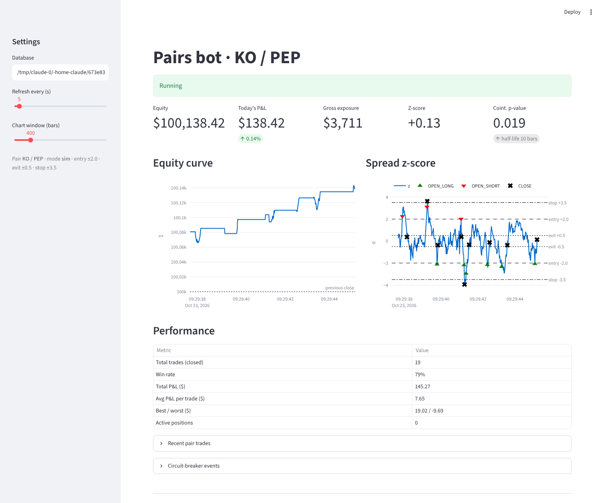

# Pairs trading bot: Alpaca paper + Streamlit

An asynchronous statistical-arbitrage bot for one stock pair. It runs on the
**Alpaca paper** account through `alpaca-py`, logs every event to SQLite, and
includes a live Streamlit dashboard with an emergency stop.


*Dashboard rendered against the offline simulator after 800 cycles. These are simulated numbers, not real results.*

## Project layout

```
pairs-bot/
├── config.py        # env-driven frozen Settings: keys, pair, z thresholds, risk limits
├── db_logger.py     # aiosqlite writer (WAL, busy_timeout, retry, JSONL fallback) + dashboard helpers
├── strategy.py      # Alpaca bar fetch, OLS hedge ratio, spread, z-score, Engle-Granger, half-life, decide()
├── execution.py     # AlpacaBroker (TradingClient paper=True), dual-leg sizing, leg-failure unwind
├── main.py          # asyncio loop: risk checks -> model -> execute -> log; persisted halt
├── app.py           # Streamlit: equity curve, z-score chart, performance table, emergency stop
├── sim.py           # offline cointegrated market + simulated broker (BOT_MODE=sim)
├── tests/           # 20 tests: math, sizing, leg risk, halts, DB concurrency, dashboard render
├── .env.example
└── requirements.txt
```

## Quick start

```bash
pip install -r requirements-dev.txt

# 1. Try everything offline (no keys, no market hours)
python main.py --mode sim --fast --cycles 800
streamlit run app.py                         # in another terminal

# 2. Paper trading
cp .env.example .env                          # add your PAPER keys
python main.py --mode alpaca --cycles 1      # smoke test: one cycle, check the log
python main.py                                # run; Ctrl-C stops cleanly
streamlit run app.py

python -m pytest -q                           # 20 tests, ~45 s
```

## How it trades

| Step | Formula | Where |
|---|---|---|
| Hedge ratio | OLS on the last 390 bars: `log A = α + β·log B` | `strategy.hedge_ratio` |
| Spread | `s = log A − β·log B − α` | `compute_spread_stats` |
| Z-score | `(s_t − mean(s, 60)) / std(s, 60)` | `compute_spread_stats` |
| Filter | Engle-Granger p-value < 0.05, β > 0, \|z\| < stop | `decide` |
| Entry | z ≥ +2.0: short A / long B. z ≤ −2.0: long A / short B | `decide` |
| Exit | \|z\| ≤ 0.5 (reverted), \|z\| ≥ 3.5 (stop), or 390 bars held (time stop) | `decide` |
| Sizing | `qty_A = ⌊$2,000 / P_A⌋`, `qty_B = ⌊β·qty_A·P_A / P_B⌋`, whole shares | `execution.plan_pair` |

The exit threshold defaults to ±0.5. Your brief gave ±2.0 for entry and exit; exiting
at the same level you entered at would close trades immediately, so exit
is set at the point where the spread has mostly mean-reverted. Change `EXIT_Z`
if you want something else.

## Safety mechanisms

| Risk | What the bot does | Test |
|---|---|---|
| Daily loss | Daily P&L = `equity − last_equity` (yesterday's close). At −$300 or −2%, whichever is tighter, it flattens all positions and halts | `test_daily_loss_limit_flattens_and_halts` |
| Emergency stop | The dashboard button writes a flag the bot reads every cycle (flatten + halt). In alpaca mode the button also calls `close_all_positions` directly, so it works even if the bot is down | `test_dashboard_stop_button...`, `test_app` |
| Restart after a halt | The halt is persisted in the database, so the bot refuses to trade until you run `--reset-halt` | same |
| Leg risk | The short leg is sent first. If the second leg fails, the first is closed immediately. If the short leg isn't borrowable, no orders are sent at all | `test_second_leg_failure_unwinds_first`, `test_unshortable_leg_sends_nothing` |
| Stale data | The bot won't act on a bar older than 180 s | `test_stale_data_blocks_trading` |
| API outages | Five errors in a row flatten and halt | `test_repeated_errors_halt` |
| Unknown positions | Existing positions in the pair's symbols at startup halt the bot without touching them | `test_unknown_positions_at_startup...` |
| Pair breaking down | Stop at \|z\| ≥ 3.5, no entries past the stop band, cointegration filter on entries | `test_broken_relationship...` |
| SQLite contention | WAL mode, 5 s busy_timeout, short transactions, a read-only dashboard connection, and a JSONL fallback | `test_dashboard_reads_while_bot_writes` |
| Live trading | `paper=True` is hard-wired and validated twice; there is no live switch | `config.py`, `execution.py` |

## What was and wasn't verified

- **Verified offline.** The full loop, every safety mechanism above, and the dashboard. The dashboard was checked with Streamlit's `AppTest` and the screenshot above.
- **Not verified against Alpaca.** This build environment can't reach Alpaca's API, and no keys were provided. The Alpaca classes and method signatures were checked against the installed `alpaca-py` 0.44.0, but have not been run against a live paper account. Run `python main.py --mode alpaca --cycles 1` during market hours first and check the log and the dashboard.
- **The simulator is optimistic by construction.** Its pair is cointegrated by design, so the 79% win rate in the screenshot says nothing about KO/PEP.

## Real-world notes

- **Cointegration on 1-minute bars is fragile.** Expect the p-value filter to block many signals. Test candidate pairs on daily or 15-minute data before trusting a pair.
- **Market orders pay the spread on both legs, twice per round trip.** On a $2,000 leg with a few cents of spread per share, costs are a large share of a 0.5σ move. The free IEX feed is also thinner than SIP.
- **Shorting needs a margin account and a borrow.** Paper accounts are margin by default.
- **Pattern-day-trader rule.** Alpaca applies the PDT rule to paper accounts under $25k equity. Intraday round trips count as day trades.
- **The loss limit is account-wide.** It uses whole-account equity, so other positions on the same paper account count toward it.
